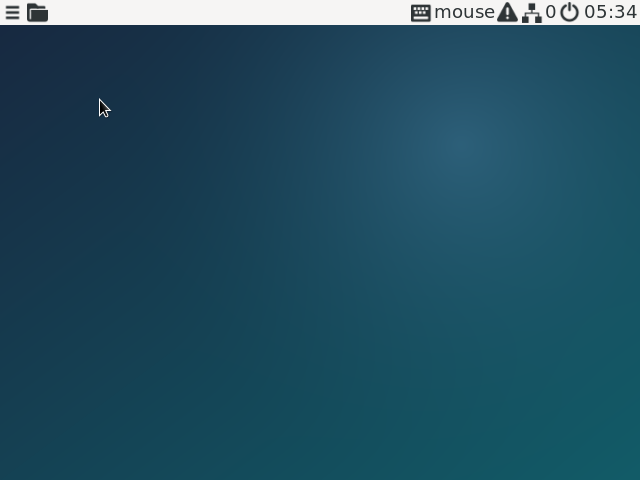
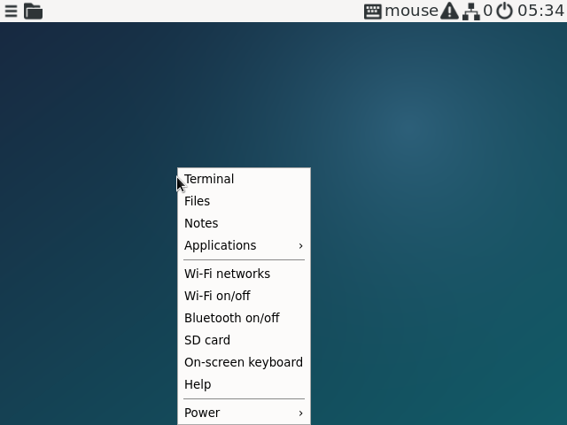
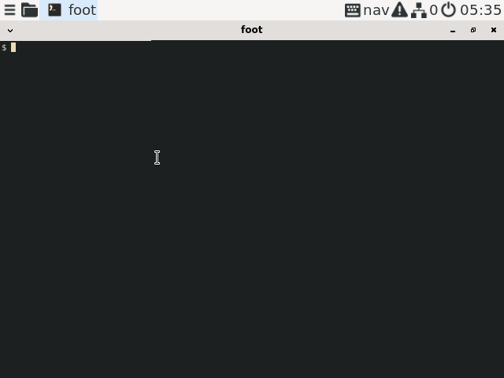
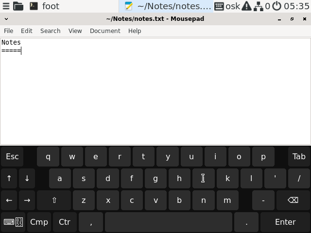
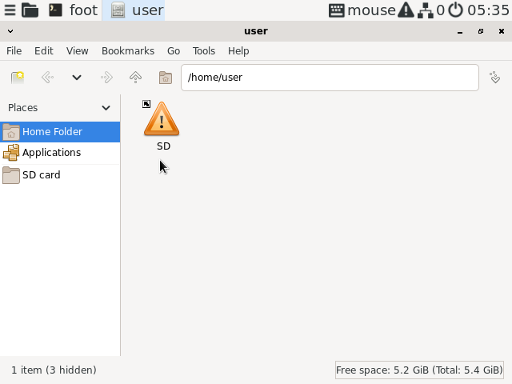
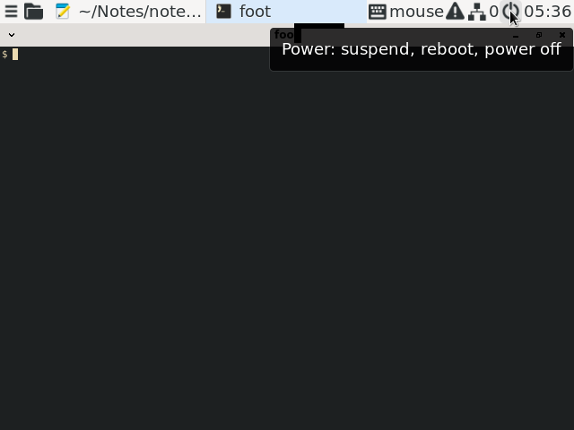

# RGOS

A small Linux OS for the **Anbernic RG35XX SP**: a pointer-driven desktop
(labwc + panel, terminal, notes, file manager) that works with the built-in
buttons or a USB/Bluetooth keyboard and mouse.

Built with Buildroot and systemd on mainline Linux, with the
[ROCKNIX](https://github.com/ROCKNIX/distribution) H700 patches for the display.

## Build

Requires macOS on Apple Silicon (or arm64 Linux) with `lima`, `jq`, `qemu`.

```bash
bin/buildbox.sh create            # build VM (once)
bin/buildbox.sh build             # RG35XX SP image   -> artifacts/rg35xxsp/
bin/buildbox.sh build qemu-arm64  # QEMU test image   -> artifacts/qemu-arm64/
```

Details (build VM, incremental builds, troubleshooting): docs/building.md.

## Documentation

- docs/system.md — how the OS works: boot chain, storage layout, power
  management, design decisions
- docs/hardware.md — the device: SoC, peripherals, drivers, button codes
- docs/apps.md — what's installed and how to drive it with the pad
- docs/testing.md — flashing, hardware verification, QEMU tests, logs

## Install

```bash
bin/flash.sh                      # list SD cards
bin/flash.sh --key ~/.ssh/id_ed25519.pub --wifi "My network" --country NL disk4
```

Put the card in slot **TF1**. Images contain no SSH keys or Wi-Fi credentials;
they are provisioned per card through the `RGOS-BOOT` partition (see
`README.txt` there, or `bin/provision.sh`). SSH is key-only.

## Controls

The pad moves the mouse pointer: **A** click, **B** right-click, **Start** main
menu, **Select** on-screen keyboard, **L2/R2** switch windows, **Menu** toggles
keys mode. Remap in `/etc/rgos/padd.conf`.

## Screenshots

QEMU, running the same image as the device (640 x 480 panel):

| | |
|---|---|
| <br>Desktop: labwc + sfwbar panel | <br>Main menu (Start) |
| <br>foot terminal | <br>On-screen keyboard (Select), pad-driven |
| <br>PCManFM | <br>Notifications (mako) |

## Test in QEMU

```bash
bin/run-qemu --key ~/.ssh/id_ed25519.pub   # window; bin/qemu-pad = handheld buttons
bin/test-qemu                              # automated smoke test
```

## License

[AGPL-3.0](LICENSE). Downloaded components keep their own licenses.
